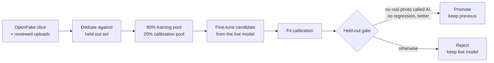
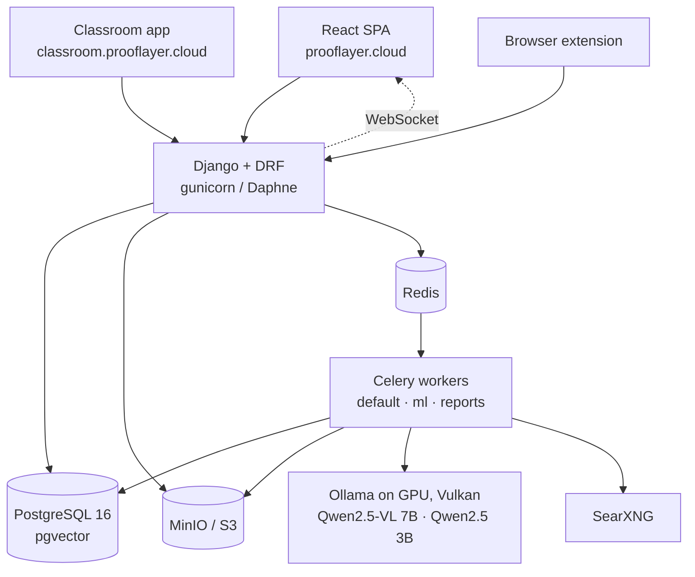

<div align="center">

# ProofLayer

**Verification lab for synthetic media and AI-written text.**
An ensemble of independent detectors, the Tribunal, examines every image, video, audio file and
essay and returns one verdict with the evidence behind it.

[Website](https://prooflayer.cloud) · [Classroom](https://classroom.prooflayer.cloud) · [API reference](https://api.prooflayer.cloud/api/docs/) · [System status](https://prooflayer.cloud/status)


</div>

---

## Contents

- [What it does](#what-it-does)
- [The Tribunal](#the-tribunal)
- [ProofLayer Classroom](#prooflayer-classroom)
- [Self-improving detector](#self-improving-detector)
- [Architecture](#architecture)
- [Tech stack](#tech-stack)
- [Getting started](#getting-started)
- [Configuration](#configuration)
- [Deployment](#deployment)
- [Testing](#testing)
- [Repository layout](#repository-layout)
- [Privacy and security](#privacy-and-security)
- [License](#license)

## What it does

| Area | Capabilities |
|---|---|
| **Images and video** | AI generation and manipulation detection, Error Level Analysis, EXIF / PNG parameters / C2PA, provenance by perceptual hash, frame sampling across whole clips |
| **Audio** | Synthetic voice and vocoder artifact detection |
| **Text** | AI-writing classifier for ru / en / fr, bypass detection (homoglyphs, invisible and hidden text), invented sources and reference formatting, originality and plagiarism with paraphrase and translation matching |
| **Education** | Schools, classes and student accounts, a plain-language teacher report, class radar, assignment shadow, verdict objections |
| **Platform** | Fact-check, compare, human review queue, batch upload, PDF reports, embeddable badge, REST API with signed webhooks, browser extension, Russian and English interface |

Every result is probabilistic and says so. A flag is a reason to look closer and to talk to the
person, never proof on its own.

## The Tribunal

Analyzers are configured in the database (`analyzers/management/commands/seed_analyzers.py`), run in
parallel as a Celery chord and combined by `analyzers/aggregator.py`. Each verdict is stamped with
the Tribunal version and a fingerprint of the exact roster and weights (`analyzers/ensemble.py`).
Measured changes are recorded in [`wiki/concepts/tribunal.md`](wiki/concepts/tribunal.md).

### Members

| Member | Weight | Signal |
|---|---|---|
| `community_forensics` | 3.5 | Community Forensics ViT-S/16 (NeurIPS 2024), calibrated |
| `custom_detector` | 3.5 | ViT fine-tuned on reviewed uploads and current generators, own calibration, retrained automatically |
| `clip_probe` | 2.5 | Linear probe on CLIP embeddings, an independent backbone |
| `ai_detector` | 1.0 | Two image classifiers behind a screenshot / diagram gate |
| `metadata` | 1.5 | C2PA Content Credentials checked against the official trust list, IPTC AI labels, Stable Diffusion / FLUX hidden watermarks, EXIF, generation parameters; a verified signature or decoded watermark is proof on its own |
| `ela` | 0.75 | Error Level Analysis, manipulation channel only |
| `llm_vision` | 1.5 | Qwen2.5-VL 7B on our GPU (about 6 s per image); must name a concrete defect, otherwise abstains |
| `video_frame` | 2.0 | Frames across the whole clip, median verdict |
| `audio_spectrogram` | 2.0 | Spectral features of synthetic voices |
| `text_classifier` | 2.5 | multilingual-e5-small fine-tuned on human essays, pre-2022 Wikipedia, current model output and humanizer rewrites; per-language calibration, per-passage scores; can flag, never convict alone |
| `text_evasion` | 2.0 | Humanizer tricks: homoglyphs, look-alike punctuation, stray accents on common words, styled / fullwidth letters, invisible characters, hidden / white / 1 pt DOCX text |

Context members never vote; a flag sends the work to human review:
`text_grade_fit` (vocabulary against the class year and the student's own level),
`text_style` (drift from the student's earlier work), `text_citations` (invented DOIs, ISBNs,
arXiv ids, links and references; APA, MLA, Chicago, Harvard, IEEE, Vancouver, GOST, ISO 690),
`text_genre` (essay, narrative, retelling, analysis, report, letter, poem) and `text_shadow`
(closeness to AI answers to the assignment). Personal comparisons wait for three earlier works so a
strong student is never flagged early.

### Measured on the held-out set

Same 245 images (100 real, 145 from 20 current generators) for every version, full production roster:

| Version | Ensemble AUC | AI caught | AI called authentic | Real called AI | Real called suspicious |
|---|---|---|---|---|---|
| 1.3 to 1.6 | 0.998 | 108 / 145 | 6 | **0 / 100** | 1 |
| 1.6.1 | 0.997 | 107 / 145 | 5 | **0 / 100** | **0** |
| 1.7.0 | 0.997 | 107 / 145 | 5 | **0 / 100** | **0** |
| **1.7.1** | 0.997 | 107 / 145 | 5 | **0 / 100** | **0** |

The hard constraint for every release: no real photo may be called AI.

## ProofLayer Classroom

A separate app at `classroom.prooflayer.cloud` for schools and universities.

- Organizations, classes with join codes and class year (grade 1 to university year 6), teacher and admin roles
- Students only hand work in and see their own results; the ProofLayer tools stay with teachers
- Teachers can check any work themselves (a scan, an email attachment) and file it under a student, so it joins that student's history and style comparison
- A compact live status signal in the header and a link back to the main ProofLayer workspace
- Each work opens with a plain answer ("Looks like the student's own work", "Worth a closer look") and one coloured tile per check, then the evidence
- The whole text is shown with the passages that read most machine-like highlighted and scored, in the app and in the PDF report
- Originality on every upload: winnowed fingerprints, e5 sentence vectors for rewording and translation, optional web search through self-hosted SearXNG
- Class radar: works built on one skeleton and sudden jumps in a student's level
- Assignment shadow: the server answers the assignment with AI the way students of different ages would and compares every work with it
- Verdict objections with deadlines, CSV export
- `manage.py seed_demo` creates demo schools with teachers, students and analysed work

## Self-improving detector

The image detector retrains itself every week (`analyzers/auto_retrain.py`, Celery beat):



Running workers pick up a promoted model without a restart, `manage.py rollback_detector` restores
the previous one, and the status page shows progress, the last decision and the live-vs-candidate
numbers. A candidate that is worse on the held-out set is rejected and the live model stays: on
2026-10-14 a candidate trained on 246 fresh images caught 96 of 145 AI images against the live
model's 107, so it was not promoted.

## Admin

`/admin/` (Django + Unfold) is the staff control room: a dashboard with system health and queue
numbers, retrain runs with "run now" and "roll back", analyzer weights edited inline, re-analysis of
any submission, objections, verdict overrides, training samples, subscriptions, shadow sets and
product update emails.

## Emails

Every email uses one dark template in the site's style (`users/templates/email/message.html`) with a
plain-text part, sent through Resend. Users get email in the language they use on the site.

| Email | When |
| --- | --- |
| Confirm your email | after registration, link valid 48 hours |
| Password reset | from "Forgot password?", link valid one hour, revokes all sessions |
| Objection to a verdict | a student disputes a verdict, sent to the class teacher |
| Product update | written in the admin in Russian and English, test to yourself, then send |
| Retrain result | to the staff member who started a retrain |

Product updates are on by default and can be turned off on the account page; each one carries an
unsubscribe link and `List-Unsubscribe` one-click headers. `manage.py preview_emails --out dir`
renders every email to HTML for a visual check. Staff can send themselves any of these emails from the Email row on
the status page and see the latest delivery results there.

## What's new

`/changelog` lists every user-facing change in Russian and English. Entries live in
`backend/api/changelog.json`, one per feature, and are loaded on every boot (`manage.py
sync_changelog`). Every Monday a Celery beat task drafts a product update email from the entries
added since the last digest; staff review it in the admin, send a test and send it. The same draft
can be made at any time with "Draft digest from changelog".

## Architecture



**Upload pipeline**

1. The client uploads a file; Django stores it in MinIO and creates a `Submission`.
2. `process_submission` computes SHA-256 and perceptual hashes; a known file reuses its verdict.
3. Analyzers fan out as a chord on the `ml` queue; documents are converted to text first.
4. `aggregate_verdicts` combines the votes, stamps the Tribunal version and fires webhooks.
5. Originality, provenance and class signals run alongside; the client follows progress live.

## Tech stack

| Layer | Technologies |
|---|---|
| Frontend | React 18, TypeScript 5, Vite 6, React Router 7, Tailwind CSS 3, TanStack Query 5, Zustand 5, Motion, Three.js |
| Backend | Python 3.12, Django 5.1, Django REST Framework, SimpleJWT, Celery 5.4, Django Channels + Daphne, WeasyPrint, Unfold admin |
| Data | PostgreSQL 16 + pgvector, Redis 7.4, MinIO |
| ML | PyTorch, Transformers, Community Forensics ViT, CLIP ViT-B/32, multilingual-e5-small, Ollama (Qwen2.5-VL 7B, Qwen2.5 3B), spaCy, librosa, OpenCV |
| Search and text | SearXNG, Trafilatura, pypdf, python-docx, wordfreq |
| Infrastructure | Docker Compose, Caddy, Cloudflare, Tailscale, Vulkan on AMD RX 6700S, Paddle, Resend, Sentry |

The full list with links is on the [Stack page](https://prooflayer.cloud/stack).

## Getting started

Requirements: Docker and Docker Compose, about 10 GB of disk for models.

```bash
git clone https://github.com/jeezdredd/prooflayer.git
cd prooflayer
make dev
docker compose exec backend python manage.py createsuperuser
```

The first start pulls the Ollama models; wait for `ollama_init` to finish before checking images.

| Service | URL |
|---|---|
| Web app | http://localhost:5173 |
| API | http://localhost:8000/api/v1 |
| OpenAPI | http://localhost:8000/api/docs/ |
| Admin | http://localhost:8000/admin/ |
| Celery (Flower) | http://localhost:5555 |
| MinIO console | http://localhost:9001 |

## Configuration

| Variable | Default | Purpose |
|---|---|---|
| `SECRET_KEY` | dev key | Django secret |
| `DATABASE_URL` | | PostgreSQL DSN |
| `REDIS_URL` | `redis://redis:6379/0` | Broker and cache |
| `AWS_S3_ENDPOINT_URL`, `AWS_ACCESS_KEY_ID`, `AWS_SECRET_ACCESS_KEY` | | MinIO / S3 storage |
| `OLLAMA_URL` | `http://ollama:11434` | Language model server |
| `OLLAMA_MODEL` | `qwen2.5:3b` | Fact-check and assignment shadow |
| `OLLAMA_VISION_MODEL` | `qwen2.5vl:7b` | Vision member, about 6 s per image on the GPU |
| `SEARXNG_URL`, `PLAGIARISM_SEARCH_PROVIDERS` | `searxng,brave,ddg` | Web search for originality |
| `RETRAIN_MIN_NEW_SAMPLES` | `50` | New examples needed before a weekly retrain |
| `RESEND_API_KEY` | | Transactional email |
| `PADDLE_*` | | Billing |
| `SENTRY_DSN` | | Error tracking (optional) |

Frontend: `VITE_API_URL`, `VITE_CLASSROOM_URL`, `VITE_MAIN_URL` in `frontend/.env.local`.

## Deployment

Production runs on a self-hosted Linux server behind Cloudflare, with Caddy in front of the compose
stack (`deploy/compose.prod.yml`).

```bash
make deploy-server
```

The deploy clones the latest commit (shallow, with stall detection and retries), builds the images,
rolls the containers and checks `/api/v1/auth/health/`. Retrained models are shipped with
`make ship-retrained` and `make ship-text`. See [`deploy/README.md`](deploy/README.md).

When the server is unreachable, a Cloudflare Worker (`deploy/cloudflare/maintenance`) answers with a
branded "we are updating the system" page in Russian or English instead of a Cloudflare error, and
with JSON 503 on the API. `make maintenance-on` shows it on purpose during planned work.

## Testing

```bash
DJANGO_SETTINGS_MODULE=config.settings.test uv run pytest backend          # backend suite
uv run python backend/manage.py eval_detectors --dataset dataset/openfake_test  # image held-out check
cd frontend && pnpm exec tsc --noEmit && npm run i18n:check                 # types and translations
```

`i18n:check` fails when any interface text has no Russian translation.

## Repository layout

```
backend/
  analyzers/    Tribunal members, text checks, aggregator, auto retrain
  classroom/    Organizations, classes, roster, radar, assignment shadow, demo data
  plagiarism/   Fingerprints, sentence vectors, web search
  content/      Submissions, upload pipeline, batches, PDF reports, widget
  factcheck/    Claim extraction and checking
  provenance/   Perceptual hash matching
  billing/      Plans, quotas, Paddle
  users/        Accounts, JWT, API keys, email
  api/          System status, roadmap, feedback
  config/       Settings, Celery, URLs
frontend/
  src/pages/        Landing, upload, results, classroom, pricing, status, legal
  src/components/   Teacher summary, text report, Tribunal brain, workspace
  src/i18n/         Translation layer and Russian dictionary
extension/      MV3 browser extension
deploy/         Production compose, deploy script, Caddy
wiki/           Engineering notes and the Tribunal changelog
```

## Privacy and security

- All detection models run on our own servers; uploads are not sent to external AI providers.
- Personal uploads are deleted after 90 days; class work is never used for training.
- Passwords are hashed with PBKDF2, API keys stored as SHA-256 hashes, webhooks signed with HMAC-SHA256.
- Files are served only through short-lived signed links.
- Training on reviewed personal uploads and web search for class originality checks are on by
  default and can be switched off on the account and school pages.
- Public endpoints are rate limited per IP; the status payload is cached for 10 seconds.

Details: [Privacy Policy](https://prooflayer.cloud/privacy) · [Data Processing terms](https://prooflayer.cloud/data-processing).

## License

Copyright (c) 2026 ProofLayer. All rights reserved.

The source code is public for transparency so anyone can see how verdicts are made. It is not open
source: no part of this repository may be copied, modified, distributed or used without written
permission from the owner.
